# Cue Editor User Guide

Cue Editor helps you review dialogue and displayed text, adjust cue timing against
video, organize scene headings and beats, and deliver an ABS (As Broadcast Script).
Use this guide for everyday editing, QC (Quality Control), and export.

**Version reference:** 2.6.5, updated October 14, 2026. Screenshots show 2.6.4.
Version 2.6.5 includes all features described in this guide. Check your installed
version in **Cue Editor → About Cue Editor**.

The screenshots use *The Lantern*, an invented practice project. You can download
the [sample project and video](../examples/README.md) to follow along.

## Contents

- [Install and update](#install-and-update)
- [Your first project](#your-first-project)
- [Find your way around](#find-your-way-around)
- [Open and save projects](#open-and-save-projects)
- [Import video and cues](#import-video-and-cues)
- [Set the timecode](#set-the-timecode)
- [Navigate and play](#navigate-and-play)
- [Edit and organize cues](#edit-and-organize-cues)
- [Manage sources](#manage-sources)
- [Find and replace](#find-and-replace)
- [Review your work](#review-your-work)
- [Label subtitles](#label-subtitles)
- [Automatic On and Off labeling](#automatic-on-and-off-labeling)
- [Re-transcribe a selection](#re-transcribe-a-selection)
- [Export and deliver](#export-and-deliver)
- [Adjust the workspace](#adjust-the-workspace)
- [Usage records and bookkeeping](#usage-records-and-bookkeeping)
- [Troubleshooting](#troubleshooting)
- [Reference](#reference)

## Install and update

### Choose the right installer

Open **Apple menu → About This Mac** to identify your processor, then visit the
[latest release](https://github.com/ReelDL-LLC/cue-editor-downloads/releases/latest).

| Your Mac | Installer |
| --- | --- |
| Apple silicon, including an Apple M-series chip | File ending in `arm64.dmg` |
| Intel processor | File ending in `x64.dmg` |

The DMG (Disk Image) is the manual installer. The update archives, block maps, and
update metadata attached to a release support the built-in updater.

1. Quit Cue Editor if it is open.
2. Download and open the installer for your processor.
3. Drag **Cue Editor** into **Applications**, replacing an older copy if prompted.
4. Open Cue Editor from Applications.

Project files remain in their existing locations. Automatic On/Off labeling is
included in the Apple silicon installer. The Intel installer supports manual
editing and review but omits that automatic labeler.

### Install an update

Choose **Cue Editor → Check for Updates…** for a manual check. The app also checks
automatically after startup and periodically while running.

When an update is offered, choose **Download Update** or **Remind Me Later**.
Downloading begins only after you accept. Once it is ready, choose **Restart and
Install**, or keep working and defer installation. The normal save-changes prompt
applies before restarting; canceling it cancels that restart.

Older installers may show trial or license prompts. If one appears, use the
license supplied with your installation or contact the person who provided it.
**New in 2.6.5:** editing does not require a license activation prompt.

## Your first project

1. Choose **File → New Project**, or open a supplied project with **File → Open
   Project**.
2. Choose **File → Add Project Video…** and select your MP4 (MPEG-4 Part 14) video.
3. Choose **File → Import Cues…**, select a CSV (Comma-Separated Values) file,
   inspect the field mapping and preview, and import it. Skip this step to create
   cues manually.
4. Open **Utilities → Import and Timecode…** and confirm the frame rate and
   timecode origin against the supplied video.
5. Select a cue in the timeline. Edit its text, source, timing, and labels in the
   left sidebar. Use **Shift+Space** to play from the cue editor.
6. Save with **Command+S**. Use **Review → Full Review** to inspect flagged issues,
   then **Review → QC review** to check every cue in order.
7. Choose **File → Export** and the deliverable you need. Review the warnings,
   enter document details where applicable, and choose the destination.

You can edit and export cues without video. The virtual timeline supports timing
and navigation, but listening and picture checks need the matching source video.

## Find your way around

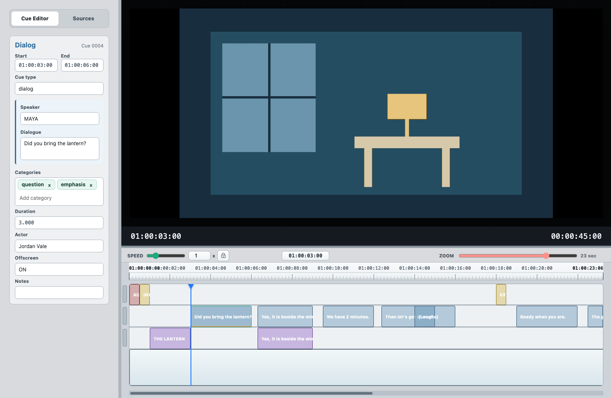

The **Cue Editor** tab on the left shows the focused cue. The **Sources** tab
lists speakers and displayed-text sources and provides quick assignment slots.
The right side contains the video, current timecode, and timeline.

The timeline toolbar contains playback speed, a playhead timecode field, and
zoom. Colored cue blocks distinguish dialogue, beats, slugs, and on-screen text.
Select a block to load its fields into the cue editor. The narrow bars to the
left of the rows select which rows cue navigation will use.

Drag the vertical divider to resize the sidebar. Drag the horizontal divider
between video and timeline to give either area more room. The video remains
fitted within its panel.

## Open and save projects

The main window title shows the filename of the opened or saved project.
A new project shows **Cue Editor** until you save it.

### Open an existing project

Choose **File → Open Project** or double-click a supported project package.
Portable Cue Editor projects use `.gooddl-cue-project`; supplied conformer
packages use `.gooddl-conformer-package`. Existing workspace and canonical
documents can also be opened through the file picker when their formats are
supported.

Use **File → Open Recent** to return to recent projects. **Open Most Recent** has
the default shortcut **Command+Shift+O**. Clearing the recent list removes its
menu entries; it does not delete project files.

A prepared production package can carry cue data, reference material, delivery
information, word timing, or episode support. Those resources enable additional
production workflows, but ordinary editing and general export do not require a
prepared package.

### Save your edits

Use **File → Save Project** or **Command+S**. **Save Project As…**
(**Command+Shift+S**) creates a copy at a chosen location. Save before closing if
you want to retain cue changes and unfinished review progress.

**Saving a project and exporting a deliverable are separate actions.** Exporting
does not by itself save the editable project or mark unsaved edits as saved.
There is an optional save step in the export dialog.

Project packages store the editing workspace and available portable support;
source video can remain a separate file. When handing a project to another user,
provide the matching video too, unless your package workflow explicitly includes
it. Do not assume that moving the project alone moves the video.

### Reconnect missing media

If the project video cannot be found, choose **File → Add Project Video…** and
select the matching file. A prepared package may compare that video with its
recorded media identity and ask you to confirm a mismatch. Verify the episode,
cut, and timing before accepting a different video.

## Import video and cues

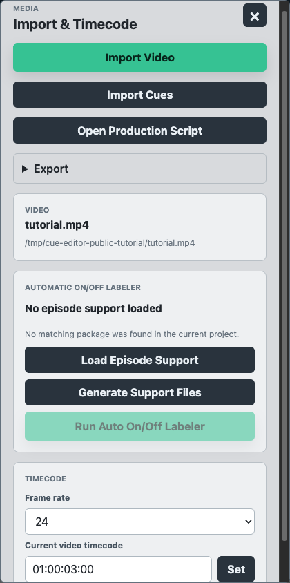

### Add video

Use **File → Add Project Video…**, or **Import Video** in **Utilities → Import and
Timecode…**. The video picker accepts MP4 video. Choose the source supplied for
the project, especially when its cues already have production timecodes.

If an audio stream needs a compatible playback copy, the app can prepare one
locally when the required conversion tools are available. Keep the original
video; a playback compatibility copy does not change the source deliverable.

### Import cue data

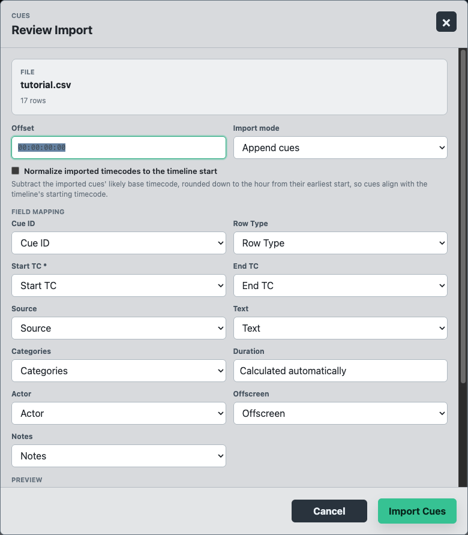

Choose **File → Import Cues…** or **Import Cues** in the Import and Timecode panel.
The **Review Import** dialog lets you:

- Inspect the selected filename, row count, and preview.
- Map the file's columns to cue fields, such as start/end timecode, text, source,
  actor, type, categories, and notes.
- Choose **Append cues** to keep existing cues, or **Replace cues** to replace
  the current cue list.
- Set an **Offset** when imported timing needs a deliberate adjustment.
- Select **Normalize imported timecodes to the timeline start** when the imported
  file uses a different timecode base. This subtracts the likely hour-based origin
  inferred from its earliest cue; it is a timing adjustment, not a picture edit.

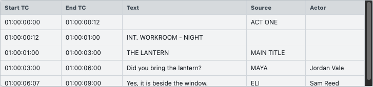

Check the preview before confirming. If the app presents repair or conform
choices, inspect the described changes before applying them. A successful import
is part of the editing history and can be undone.

## Set the timecode

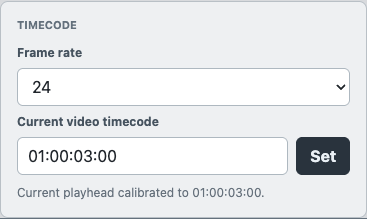

Timecodes identify hours, minutes, seconds, and frames, usually shown as
`HH:MM:SS:FF`. For example, `01:00:03:12` means one hour, three seconds, and twelve
frames. A video's elapsed time and its production timecode can have different
origins.

1. Open **Utilities → Import and Timecode…** (**Command+Shift+I**).
2. Set **Frame rate** to match the source. The panel offers 23.976, 24, 25,
   29.97 non-drop, and 30.
3. Seek to a frame whose production timecode you know.
4. Enter that value in **Current video timecode** and choose **Set**.
5. Check another known point and an existing cue before continuing.

At 24 frames per second, changing one frame changes elapsed time by 1/24 of a
second. The correct frame rate is essential for frame-level adjustments.
Projects may carry their own timing basis, including drop-frame information;
the frame-rate picker explicitly labels its 29.97 option **non-drop**. Follow the
production's supplied timing basis and do not substitute a different rate merely
to make a displayed number match.

To jump directly, enter a timecode in the playhead field above the timeline and
commit it. Editing a cue's **Start** or **End** changes that cue's boundary rather
than just seeking the playhead.

## Navigate and play

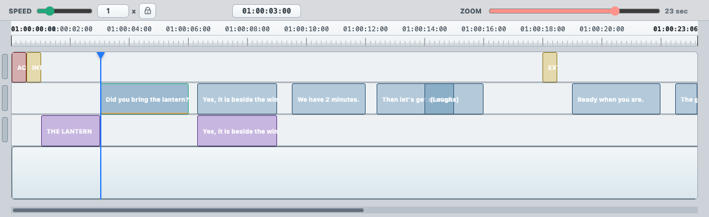

### Select and navigate

Click a cue block to focus it. Use **Command-click** for individual selections and
**Shift-click** for a range. Drag a selection box in the cue area to select cues.
**Command+A** selects available cues when the timeline has focus.

Cue moves and edge resizes require at least 6 pixels of horizontal pointer
movement. Small movements still select the cue without changing its timing.
Once dragging begins, you can move back toward the starting point for fine
adjustments. This protection also applies to selected groups.

Use **[** and **]** to move to the previous and next cue. **Shift+[** and
**Shift+]** extend the selection. **3** jumps to the selected cue's start and **4**
to its end. **Enter** edits the selected cue. From a cue editor field, **/** or
**Enter** returns focus to the timeline when that field's editing behavior allows
it.

Click the navigation bars at the left of the cue rows to restrict cue navigation
to the selected rows. Overlapping cues use tabs within their assigned row; choose
a tab to reach the cue you want. Layout settings control which types occupy each
row.

### Move the playhead

Click or drag on the playback timeline. Use the horizontal scrollbar for another
part of the episode and the **Zoom** slider for a wider or tighter view.

With the timeline focused, **-** and **=** step backward and forward one frame.
**Command+-** and **Command+=** move twelve frames. The keyboard reference lists
additional transport commands and numeric-keypad controls.

### Play a cue or the timeline

| Action | Default shortcut |
| --- | --- |
| Play or pause outside a text field | Space |
| Play the selected cue | Shift+Space in the timeline |
| Play the selected cue from the current playhead | Option+Space |
| Start playback while a cue field retains focus | Shift+Space in the cue editor |
| Increase playback speed through the shortcut's steps | Control+Space |

Ordinary Space and arrow keys retain their text-editing behavior in editable
fields. **Shift+Space** is the playback shortcut intended for use while editing.
The **Transport → Play/Pause** menu is also available.

### Adjust speed

**New in 2.6.5:** use the slider or number field to select **0.1× to 5×**, in
**0.1× increments**. The review window shares the editor's current speed. Changing
speed during playback keeps the playhead continuous.

Click the padlock beside the speed controls to retain your speed across pauses.
When unlocked, pausing resets the speed to 1×. In 2.6.3, the editor instead uses
its earlier speed selector, while review has its own speed controls.

Use **Settings → Playback… → Playback follows playhead** to choose whether the
timeline scrolls beneath the playhead during playback.

## Edit and organize cues

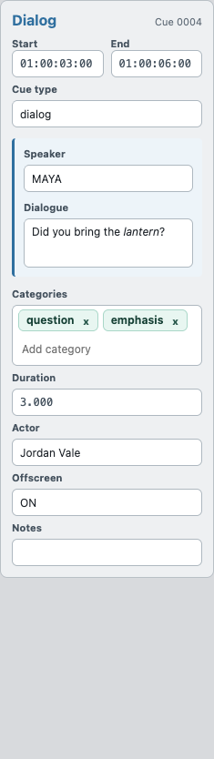

### Choose the cue type

| Type | What it represents | Typical entry |
| --- | --- | --- |
| Dialog | Spoken dialogue or a vocal annotation | Speaker `MAYA`, text `Did you bring the lantern?` |
| Slug | A scene heading | `INT. WORKROOM - NIGHT` |
| Beat | An act, sequence, or other structural marker | `ACT ONE` |
| On-screen text | Words displayed in the picture | Source `LIVE TEXT`, text `OPEN UNTIL MIDNIGHT` |

The cue editor adapts its fields to the selected type. Use **Cue type** and its
suggestions to change type. Existing slug and beat suggestions help keep repeated
headings and sequential beat names consistent.

### Edit fields

Select a cue and edit its **Start**, **End**, speaker/source, text, categories,
actor, offscreen label, or notes. **Duration** is calculated from timing. Commit
edits by leaving the field or using its applicable confirmation key. If an entry
is rejected, correct the value rather than assuming it was saved.

The actor field records a performer separately from the character/source.
For dialogue shared by two speakers, separate their names with ` | `, for example
`MAYA | ELI`.

Suggestions use **Tab** to accept and **Escape** to dismiss where shown. Source
suggestions and nonverbal completions can reduce repeated typing. Review suggested
text before accepting it.

### Format italics

Select text and choose **Edit → Italic** or press **Command+I**. The same command
can toggle italic typing at the caret. Italic formatting survives editing,
Undo/Redo, project saves, and all three Word export variants.

Plain cue CSV text does not itself encode styled Word text. Keep the editable
project or applicable metadata companions when formatting must be preserved in
a production handoff.

### Add and remove categories

Categories describe observable cue properties and review outcomes. Multiple
categories can belong to one cue. Use canonical suggestions rather than inventing
a new spelling.

**New in 2.6.5:** categories appear as individual chips. Type into **Add category**
and accept a suggestion; remove a chip with its **×** button. Suggestions omit
already assigned categories. Earlier versions use the categories text field.

Automatic categories can change after committed edits, while manual choices and
their review context are retained where applicable. A category such as `perfect`
records a supported raw/reference comparison; it does not mean every cue was
reviewed, nor does approving a review automatically prove reference correctness.
See the [category reference](categories.md) for all supported labels.

### Mark speaker visibility

The offscreen field uses these production labels:

| Label | Meaning | Default timeline key |
| --- | --- | --- |
| ON (Onscreen) | Speaker is visible during the cue | Numpad 0 |
| OS (Offscreen) | Speaker is not visible during the cue | Arrow Down |
| OS/ON (Offscreen then Onscreen) | Speaker becomes visible during the cue | Arrow Left |
| ON/OS (Onscreen then Offscreen) | Speaker goes out of view during the cue | Arrow Right |
| VO (Voiceover) | Voiceover narration or another production-defined voiceover case | Arrow Up |

Apply visibility shortcuts with the timeline focused; arrow keys inside a text
field are cursor controls. Listen and check the picture to choose the correct
label. Blank values remain review items. During On/Off review, a blank value can
be resolved as `ON` with the review action or **Command+Enter**.

### Add, split, merge, and delete

- **Add dialogue:** move the playhead and press **A** with the timeline focused.
- **Add a slug:** **Command+Option+S**.
- **Add a beat:** **Command+Option+B**.
- **Split:** place the playhead inside the selected cue and press **Shift+S**.
- **Merge:** select cues of the same type and press **Command+M**. Different cue
  types are not merged together.
- **Duplicate in place:** select cues and press **Command+D**.
- **Delete:** select cues and press **Backspace** or **Delete**.

**New in 2.6.5:** merging cues whose text is identical keeps one copy of that text
and combines applicable italic formatting. Different texts are joined in cue
order. Check the resulting timing, source, and categories after any merge.

Copy, cut, and paste operate on selected cues when the timeline has focus and on
text when a text field has focus. **Command+Z** undoes cue changes;
**Command+Shift+Z** redoes them.

### Adjust timing precisely

Edit the Start and End fields directly, drag a cue boundary, or use shortcuts:

| Action | Default shortcut with timeline focus |
| --- | --- |
| Move selected cues one frame earlier | Option+- |
| Move selected cues one frame later | Option+= |
| Set the cue start to the playhead | Shift+- |
| Set the cue end to the playhead | Shift+= |

For displayed text, verify its first and last visible frames against the picture.
Inclusive displayed-text timing is retained through editing and export, including
one-frame appearances.

### Edit in the Cue List

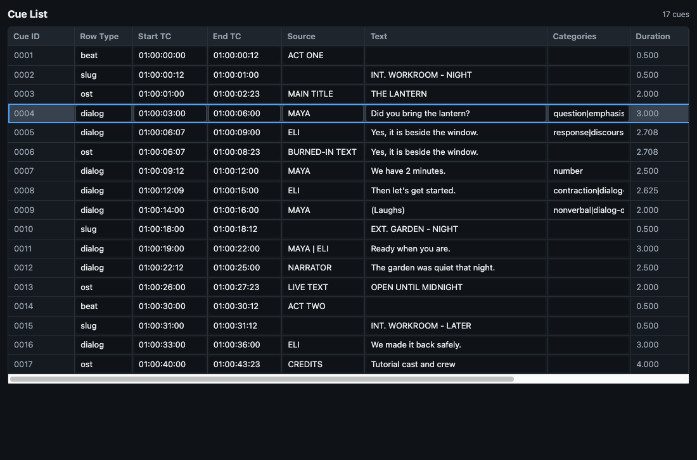

Choose **Utilities → Cue List…** (**Shift+L**) for a table view of the same cues.
Select a row to focus that cue and edit supported fields in the table. Selection
and edits stay connected to the main editor. Cue identifiers and duration are
read-only; duration follows start/end timing. Scroll horizontally for columns
such as actor, offscreen, and notes.

## Manage sources

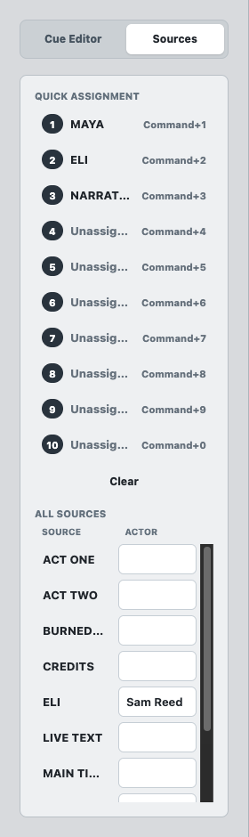

Open the **Sources** tab to see **All Sources** and **Quick Assignment**. Select a
source and assign it to a quick slot using keys **1–9** or **0** for slot 10 while
the source list has focus. With cues selected in the timeline, **Command+1**
through **Command+9**, or **Command+0**, assigns that slot's source.

Use **Clear** to clear the quick assignment list. Source names and actor names
remain separate. When editing names, check the affected cues and use Undo if the
result is not what you intended.

For OST (On-Screen Text), use the source that explains where the words appear:

| Stored source | Use |
| --- | --- |
| BURNED-IN TEXT | Text added to the picture |
| MAIN TITLE | The main title |
| CREDITS | Credits |
| VFX TEXT (Visual Effects Text) | Text created as part of visual effects |
| LIVE TEXT | Text present in the photographed scene |
| PRODUCTION LOGO | A production logo |
| A speaker name | Subtitles attributed to that speaker |

Legacy generic `ON-SCREEN TEXT` is upgraded to `BURNED-IN TEXT`; `PRACTICAL TEXT`
becomes `LIVE TEXT`. Cue data retains specific sources. In Word documents,
`MAIN TITLE` remains distinct, named-speaker displayed text becomes `SUBTITLE`,
other applicable displayed text uses `ON-SCREEN TEXT`, and credit rows are omitted.

## Find and replace

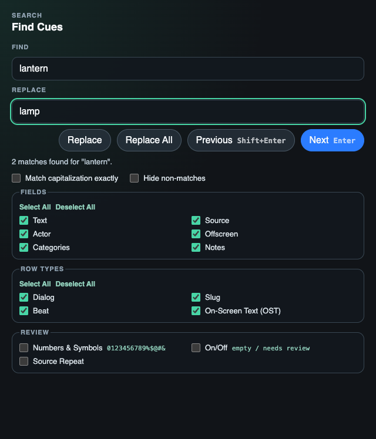

Choose **Utilities → Find and Replace…** or **Command+F**.

1. Enter text in **Find**.
2. Select the fields to search: Text, Source, Actor, Offscreen, Categories, or
   Notes. Use **Select All** or **Deselect All** for a quick reset.
3. Restrict **Row Types** if only dialogue, slugs, beats, or displayed text should
   match.
4. Enable **Match capitalization exactly** when case matters.
5. Use **Next** or **Enter** and **Previous** or **Shift+Enter** to move among
   matches.
6. Enter replacement text and use **Replace** for the current match or **Replace
   All** for matching content in the chosen scope.

**Hide non-matches** hides other cues from the working view and cue navigation.
It does not delete them. Clear the search and restore the filters to see the full
project again. Search replacements preserve applicable italic formatting and
participate in Undo/Redo.

The **Review** filters find Numbers & Symbols, On/Off items, and Source Repeat
items. These are focused search workflows; use Full Review for the complete
guided issue sequence.

## Review your work

### Full Review

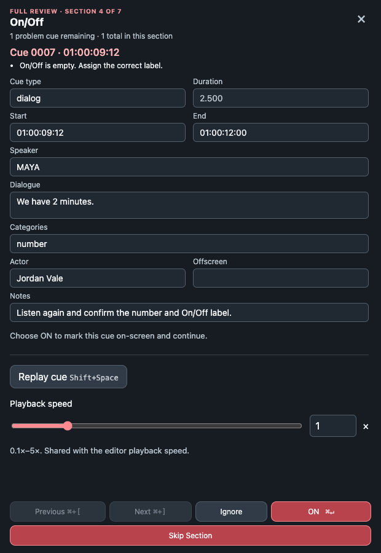

Choose **Review → Full Review** (**Command+R**). The app guides you through these
sections:

| Section | What to inspect |
| --- | --- |
| Empty Fields | Required cue content or source fields that are missing |
| Source Repeats | Consecutive source cases that need editorial review; slug repeats are flagged when their text matches |
| Duplicate Cues | Repeated cue content and timing requiring review |
| On/Off | Blank visibility values and automatic assignments marked for review |
| Numbers & Symbols | Digits and symbols that may require a spoken-form or editorial decision |
| Basic Corrections | Punctuation, capitalization, repeated words, spacing, and unmatched brackets or quotes |
| Timing | Invalid or questionable cue boundaries |

Edit the highlighted cue in the review window or main editor. **Resolved** moves
past a corrected issue; **Ignore** continues when you deliberately retain it.
Ignoring an item is a review decision, not an automatic correction. Use the
displayed controls to move back, forward, or replay the cue. Review fields share
the main editor's validation and Undo/Redo history.

Review highlights the field and, where applicable, the exact text that needs
attention. **New in 2.6.5:** Source Repeats and On/Off steps do not automatically
enter edit mode, so you can navigate before choosing to edit.

### Review every cue

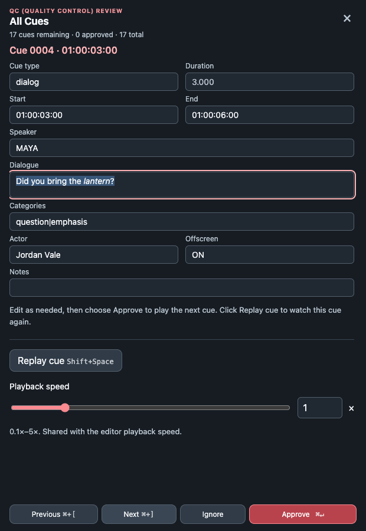

Choose **Review → QC review** (**Command+Shift+R**) for every cue in timeline
order. The focused cue plays automatically. Correct it if needed, then choose
**Approve** (**Command+Enter**) to advance and play the next cue. **Replay cue**
restarts the current cue. Approving records that review step; it does not make
automatic category evidence into a verified reference comparison.

Both review modes include playback speed and editable cue fields. On a beat or
slug, the video alternates between the cue's first frame and the preceding frame
every half second to help you check a scene boundary. Changing the start time
updates the comparison. Playback, manual seeking, changing cue, or closing the
review ends it.

### Pause and resume review

Save the project to retain unfinished Full Review or Quality Control progress,
including the current cue, decisions, and review speed. Reopening the project
leaves that progress dormant until you start the same review mode again. Choose
**Continue review**, **Start over**, or **Not now** when prompted. A completed
review does not prompt you to resume.

Use **Command+[** and **Command+]** for previous/next review navigation. The
[keyboard reference](keyboard-shortcuts.md) includes review and editing shortcuts.

## Label subtitles

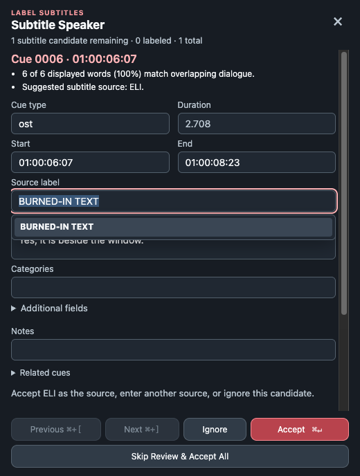

Choose **Utilities → Label Subtitles**. This workflow looks for displayed text
that overlaps dialogue and shares at least **85 percent** of its displayed words.
It suggests the dialogue speaker as the displayed-text source.

Inspect the text, timing, and speaker. Accept the suggestion, edit the source
before accepting, or skip the candidate. **Skip Review & Accept All** applies the
remaining suggestions as one undoable bulk operation. Matching words are a
review aid; check ambiguous speakers against the picture and audio.

## Automatic On and Off labeling

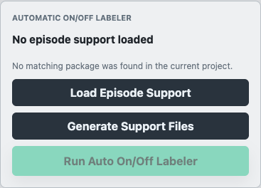

On Apple silicon, choose **Utilities → Automatic On/Off Labeler…**. This feature
uses the matching project video, current cues, and episode support information.

1. Import the matching video and cues.
2. Let the app load matching episode support automatically, or choose **Load
   Episode Support** to select the supplied episode-support archive (`.zip`).
3. If your production workflow provides the required inputs, **Generate Support
   Files** prepares local support. An ordinary video-only project may not have
   everything this step needs; read the panel's status message.
4. Choose **Run Auto On/Off Labeler** when it becomes available.
5. Inspect the result report and review markers. Use On/Off review to confirm
   labels that need attention.

Progress and **Cancel** are available while the job runs. If the cues change
during a run, the app can require a new run rather than applying results to a
different cue snapshot. Automated assignments are suggestions for review, not a
guarantee that every speaker visibility transition is correct.

**New in 2.6.5:** confident on-screen results are retained as `ON`. The Intel
installer does not include automatic On/Off labeling; its manual labels and
On/Off review remain available.

## Re-transcribe a selection

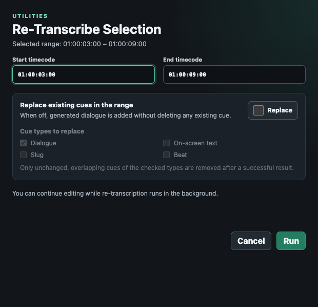

Re-transcription generates dialogue for a selected media range. It needs an
installed GoodDL transcription engine, its dependencies and models, and a
normalized episode with the required workflow and transcription artifacts. The
engine and models are external to the Cue Editor installer. A standalone video
and manually created cue project may therefore lack what this operation needs.

1. Drag across the **upper half of the audio area below the cue rows** to highlight
   a time range.
2. Choose **Utilities → Re-Transcribe Selection** (**Command+Shift+T**).
3. Check or edit the start and end timecodes.
4. Leave **Replace existing cues in the range** off to add dialogue alongside
   existing cues. Turn it on only when you want replacement.
5. For replacement, choose the eligible cue types. Dialogue is selected by
   default; displayed text, slugs, and beats remain unless you select them.
6. Choose **Run** and continue editing while the separate progress window works.

Replacement is applied after a successful result to eligible overlapping cues
that have not changed since the job began. Edits and additions made while it runs
are preserved. A failed or empty result keeps the existing cues.

The completion notice provides **Jump to section**, **View report**, **Undo**, and
**Dismiss**. Notification Undo is available while that insertion is the most
recent edit; the insertion and optional deletions form one undoable operation.
If the project or video changed during the job, inspect the retained report
instead of expecting insertion into the new project. Quitting stops an active
job.

Speaker identification may be skipped when the needed character dossier or
policy is missing. Review generated speaker labels; a successful transcription
does not establish that speaker identification ran successfully.

## Export and deliver

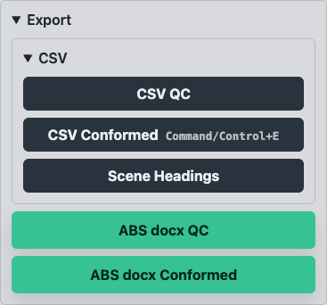

### Choose a deliverable

Open **File → Export**, or expand **Export** in Import and Timecode.

| Deliverable | Use |
| --- | --- |
| CSV QC | Cue rows with a Quality Control filename marker |
| CSV Conformed | Cue rows with a conformed filename marker |
| Scene Headings | Only slug cues and their timecodes; new in 2.6.5 |
| ABS docx QC | Three Word document variants with Quality Control naming |
| ABS docx Conformed | Three Word document variants with conformed naming |

Quality Control and Conformed export the same current cue content; their naming
identifies the deliverable stage. CSV names use `.QCed_abs.csv` or
`.conformed_abs.csv`. Scene Headings uses `.scene_headings.csv`.

**New in 2.6.5:** the CSV choices are grouped in a submenu. Earlier versions show
their cue-export choices directly.

### Resolve or accept review findings

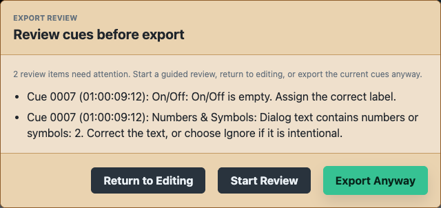

The export warning uses the same findings as Full Review. Choose to return to
editing, start guided review, or **Export Anyway** with the current cues. If the
content changes while you are confirming warnings, the app may ask again.

General cue and Word export can continue after accepted review warnings. Video,
prepared production metadata, a known cut, a prior project save, and portable word
timing are not prerequisites for ordinary document export. Word export does
require at least one cue and a writable output location.

### Set Word document details

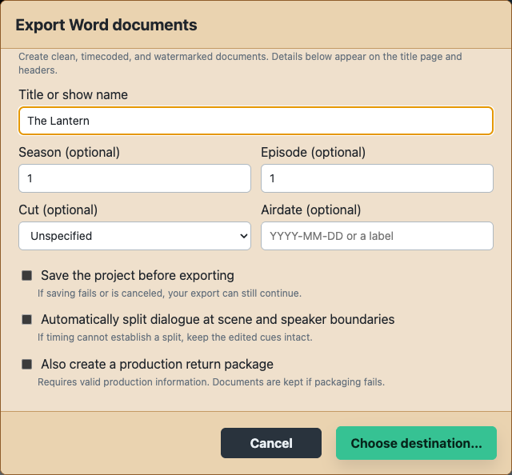

Each Word export opens **Export Word documents**. Confirm or edit the title,
season, episode, cut, and airdate. You may clear optional fields. An empty title
becomes `Untitled`. An unspecified cut omits a locked/final label. Airdate can be
a date or a label such as `To be announced`.

Choose **Choose destination…** and select an output folder. The app creates a new
timestamped subfolder containing:

- A clean Word document.
- A timecoded Word document.
- A timecoded document with a confidentiality watermark.

Previous Word exports are retained. The bundled title-page template supplies a
general layout; a damaged or unavailable template can be replaced by a built-in
fallback with a notice. Document details remain in the workspace and are retained
when you next save the project.

### Choose optional export steps

| Option | Default | Effect |
| --- | --- | --- |
| Save the project before exporting | Off | Attempts to save the editable project; a canceled or failed save is reported without withholding the export |
| Automatically split dialogue at scene and speaker boundaries | Off | Uses available portable timing; edited dialogue remains intact if timing cannot support a split |
| Include a companion lineage file | On for cue CSV export | Saves cue identity and ancestry alongside cue data; a companion-file failure does not discard the CSV |
| Also create a production return package | Off | Creates a production handoff when compatible prepared delivery data and matching media/details are available |

Leave automatic splitting off when you want to export the edited dialogue cues
exactly as they are. It is not a requirement for export.

### Return work to production

A production return package is separate from general export. It needs compatible
delivery information, matching document details, a known cut, a valid prepared
template, and accepted source video. If those checks fail, the Word documents can
still be exported and the return-package problem is reported.

When created, send **`RETURN_TO_PRODUCTION.gooddl-results`** back through your
production's handoff process. It contains the saved documents and applicable cue,
lineage, usage, and receipt data. It does not contain the source video or the full
original canonical document. Keep the editable project for future revisions.

### Recover an export

If the destination cannot be written, choose **Choose Another Location**. Any
files already written are retained and their location is reported. A retry
creates a fresh export rather than deleting partial output. Optional saving,
lineage, usage publication, or return-package warnings do not remove the
successfully written deliverable.

Canceling a destination picker writes no new deliverable. Confirm the output
files before sending them to the recipient.

## Adjust the workspace

### Put cue types on separate rows

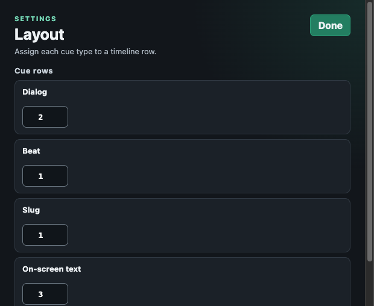

Choose **Settings → Layout…**. Assign Dialog, Beat, Slug, and On-screen text to
rows **1–4**. More than one type can share a row. Row numbers must be consecutive:
use row 2 before row 3, and row 3 before row 4. The setting persists between
sessions. Overlapping cue tabs remain inside their assigned rows.

### Choose scrolling during playback

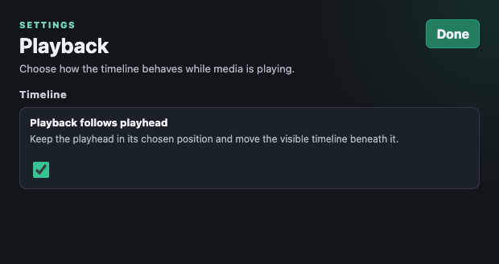

Choose **Settings → Playback…**. **Playback follows playhead** keeps the playhead
in its chosen position and moves the visible timeline beneath it. Disable it
when you prefer the alternate scrolling behavior. The setting persists.

### Customize shortcuts

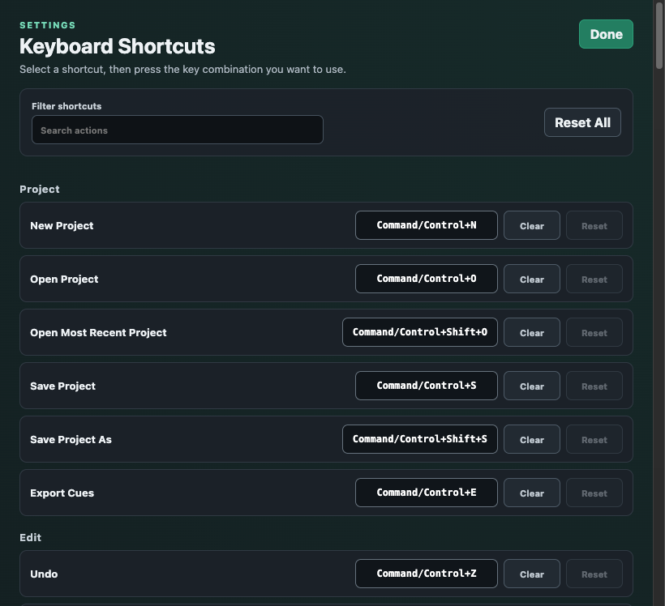

Choose **Settings → Keyboard Shortcuts…**. Select a command's shortcut control
and press the replacement key combination. Resolve reported conflicts before
using the new binding. Reset an individual command or use the reset-all control
to restore defaults. Settings are saved locally.

Shortcuts have scopes: an action may apply to the timeline, a cue field, the
Sources list, or a review window. The same physical key can have different
behavior depending on focus. Numeric-keypad commands require the corresponding
keypad keys. See [every default shortcut](keyboard-shortcuts.md).

## Usage records and bookkeeping

Cue Editor can retain work and usage metadata with project and export workflows.
These records can support a prepared production handoff. They distinguish
accepted editing actions from mere key presses; a cue merge is not counted as a
text rewrite. A usage record does not establish transcription accuracy.

**New in 2.6.5:** when ReelDL bookkeeping has been configured on the computer,
conformed and Quality Control cue/document exports report a work event. Reported
work time uses the newest usage record for the episode. Scene Headings exports
and test runs do not report billable work. Bookkeeping is optional: an error
reporting the event is a warning and does not remove the exported files.

If bookkeeping is part of your production workflow, check the export notice and
confirm the recorded episode and work time through that workflow. An ordinary
Cue Editor installation does not require bookkeeping configuration to edit or
export.

## Troubleshooting

| What you see | What to do |
| --- | --- |
| Empty video panel or missing video | Add the matching MP4 through File → Add Project Video. Verify the episode and cut if prompted about a mismatch. |
| Cues and picture are offset | Confirm the frame rate, calibrate Current video timecode at a known frame, and check whether cue import applied an offset or normalization. |
| Some cues seem to have disappeared | Clear Find Cues filters and Hide non-matches. Check selected navigation rows and scroll/zoom. These controls can hide or skip cues without deleting them. |
| A key types text instead of moving a cue | Check focus. Ordinary typing stays in an editable field. Return focus to the timeline for cue shortcuts, or use Shift+Space for playback while editing. |
| Speed returns to 1× after pausing | In 2.6.5, enable the padlock beside playback speed. Check your version if that control is absent. |
| Re-Transcribe Selection is disabled | Highlight a time range in the upper half of the audio area and check that another job is not running. |
| Re-transcription reports missing dependencies or episode data | Ask the production/operator who prepares GoodDL episodes to verify the external engine, models, and normalized episode inputs. The installer alone does not supply that engine. |
| Generated speakers are unknown or identification was skipped | Review and assign sources manually. Successful generated dialogue and successful speaker identification are separate outcomes. |
| Automatic On/Off Labeler is absent | Check whether you installed the Intel build. Automatic labeling is included only in the Apple silicon build. |
| Automatic labeler buttons are disabled | Import matching video and cues, load matching episode support, and read the panel's prerequisite/status message. |
| A category will not save | Choose a canonical category from suggestions. Review the category reference and correct an unrecognized spelling. |
| Export warns about incomplete review | Fix the listed items, start Full Review, or deliberately choose Export Anyway. Verify the delivered output afterward. |
| Export destination fails | Choose Another Location, confirm write permission and free space, and inspect any partial output already retained. |
| Return packaging fails after document export | Keep the written Word documents. Verify prepared delivery data, cut, template, document details, and matching video before retrying the optional package. |
| Reopening does not resume review automatically | Start the same review mode to see Continue review, Start over, or Not now. Save progress before closing. |
| An update check fails while offline | Reconnect and use Check for Updates again. Continue editing the installed version. |
| A newer feature is missing | Check About Cue Editor and the latest published release. This guide identifies features added in 2.6.5. |

For a reproducible problem, [open an issue in the public repository](https://github.com/ReelDL-LLC/cue-editor-downloads/issues).
Include the Cue Editor version, Mac processor, the menu/action involved, the error
text, and steps to reproduce. Use a small practice example when possible and omit
confidential production files from a public issue.

## Reference

- [Default keyboard shortcuts](keyboard-shortcuts.md), including numeric keypad
  and quick source assignments.
- [Category names and meanings](categories.md).
- [Practice project and video](../examples/README.md).
- [Download and installation overview](../README.md).
- [Published releases and version notes](https://github.com/ReelDL-LLC/cue-editor-downloads/releases).
